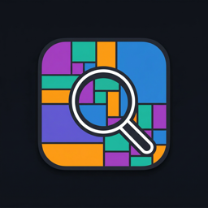
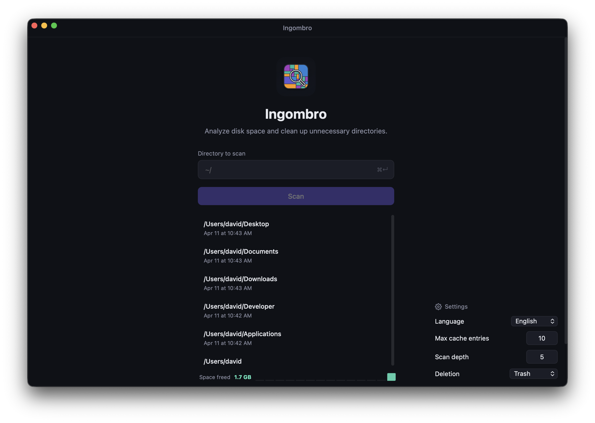
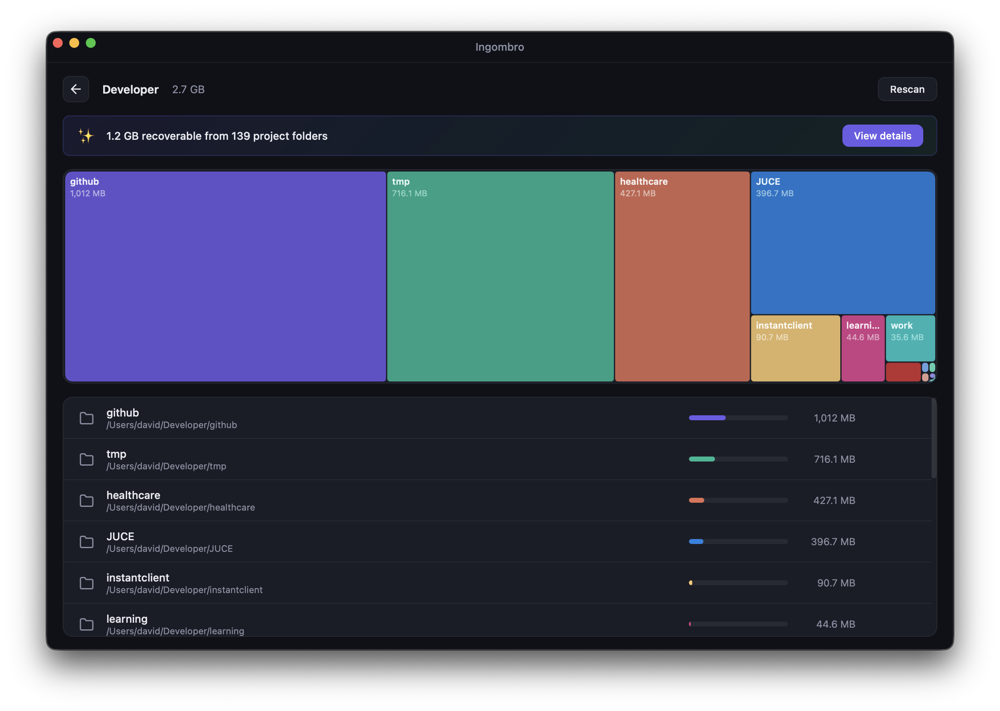
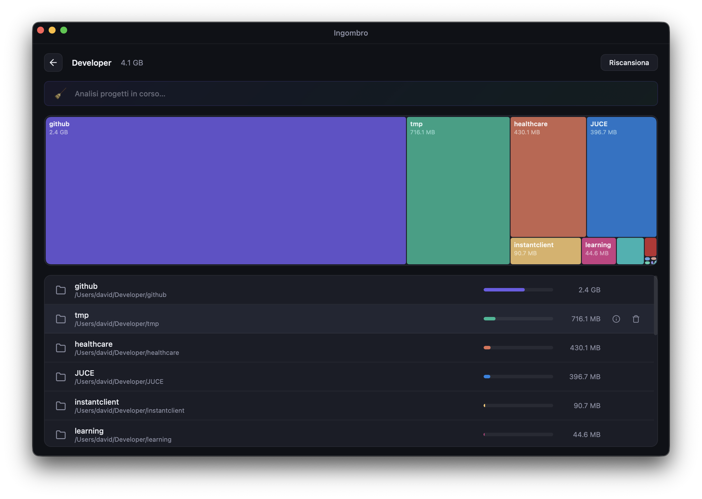
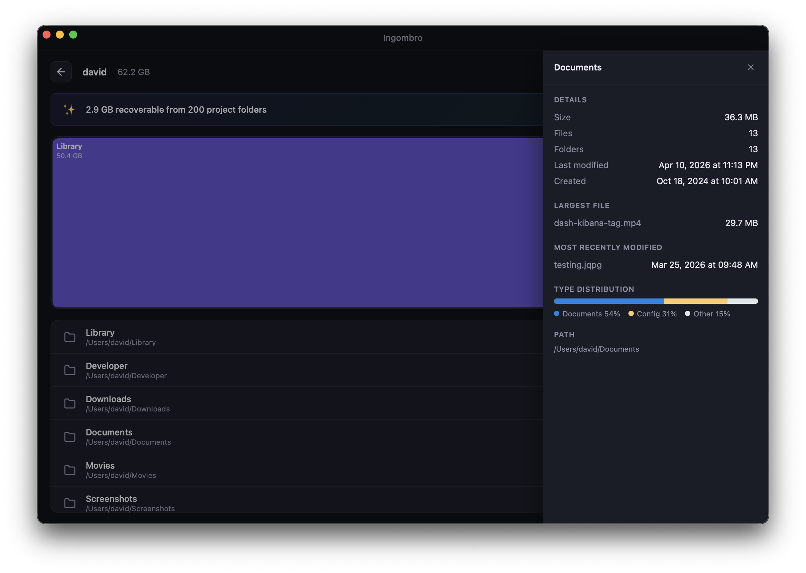
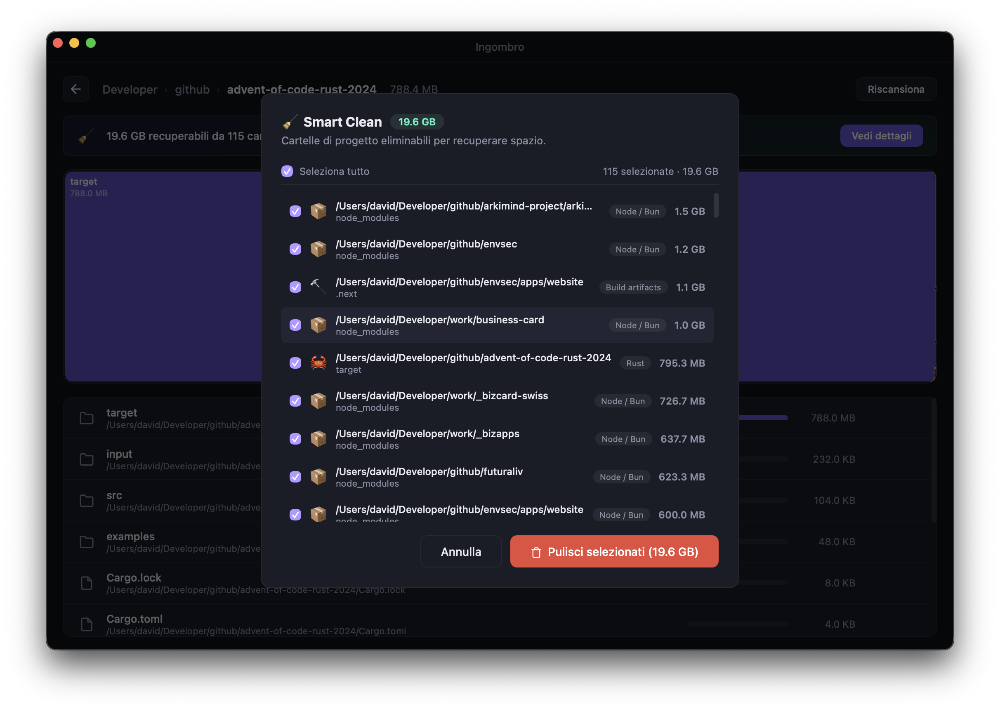
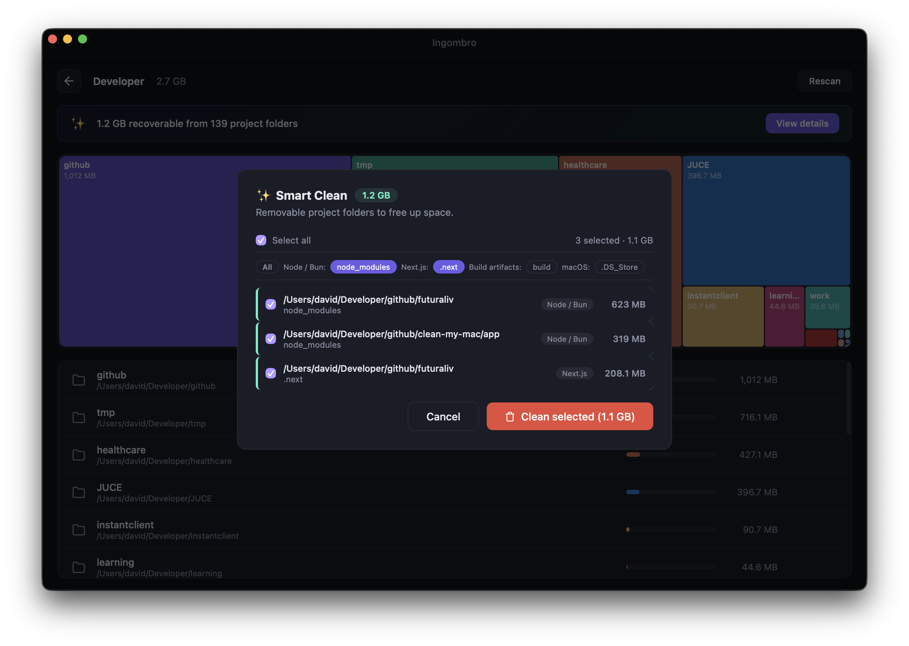

# Ingombro

<p align="center">
  
</p>

<p align="center">
  Analyze disk space and clean up unnecessary directories.
</p>

---

Ingombro is a macOS desktop app built with [Electrobun](https://electrobun.dev/) and [Bun](https://bun.sh/). It scans any directory, visualizes disk usage with an interactive treemap, and helps you free up space by removing bloated project folders like `node_modules`, `target`, `.venv`, build caches, and more.



## Features

### Interactive treemap

Proportional visualization of disk usage. Click any folder to drill down with smooth transition animations.



### Path autocomplete

Start typing a path and get instant directory suggestions. Supports `~` expansion and nested paths.



### File and folder preview

Side panel with detailed info: size, dates, largest file, most recently modified, file type distribution chart, and text/image previews.



### Smart Clean

Automatic detection of removable folders across your projects. The banner and item list update as you navigate into subdirectories, showing only what's relevant to the current folder.

| Category | Detected folders |
|---|---|
| Node / Bun | `node_modules`, `.parcel-cache`, `.turbo` |
| Frameworks | `.next`, `.nuxt`, `.svelte-kit`, `.astro`, `.angular`, `.docusaurus` |
| Python | `__pycache__`, `.venv`, `venv`, `.tox`, `.pytest_cache`, `.mypy_cache`, `.ruff_cache`, `htmlcov` |
| Rust / Java | `target`, `.gradle` |
| Elixir | `_build`, `deps`, `.elixir_ls` |
| Zig / Haskell | `zig-cache`, `zig-out`, `.stack-work` |
| Ruby / PHP / Go | `vendor`, `.bundle` |
| iOS / Flutter | `Pods`, `.dart_tool`, `.pub-cache` |
| Build artifacts | `build`, `dist`, `.cache` |
| Infrastructure | `.terraform`, `.cdk.out`, `.serverless` |
| AI / ML | `.ipynb_checkpoints`, `mlruns`, `wandb`, `lightning_logs` |
| Design | `RECOVER`, `.affinity-autosave`, `Sketch Previews` |
| Video | `Media Cache`, `Render Cache`, `Render Files`, `proxy` |
| Music / DAW | `Bounced Files`, `Freeze Files`, `Rendered`, `fl_studio_cache` |
| macOS / Windows | `.DS_Store`, `Thumbs.db`, `Desktop.ini` |

Filter by project type, select items individually or in batch, and clean with a single click.





### Cached analysis results

Scan results and Smart Clean analysis are cached. Reopening a directory from cache loads instantly without re-scanning. A new scan automatically invalidates the previous cache.

### Internationalization

7 languages supported out of the box:

🇮🇹 Italiano · 🇬🇧 English · 🇪🇸 Español · 🇫🇷 Français · 🇩🇪 Deutsch · 🇧🇷 Português · 🇯🇵 日本語

Automatic detection of system language with manual override.

## Terminal UI

Ingombro also ships a keyboard-driven terminal interface in the style of [lazygit](https://github.com/jesseduffield/lazygit) and [lazydocker](https://github.com/jesseduffield/lazydocker), built with [OpenTUI](https://opentui.com). It shares the scanner, Smart Clean rules, cache, settings and stats with the desktop app (`~/.ingombro`), so a folder scanned in one opens instantly in the other.

```bash
bun run tui ~/Developer          # run from source
bun run build:tui                # single binary in build-cli/ingombro
./build-cli/ingombro ~/Developer --rescan
```

```
╭─ [1] Scans ─────────────────────╮╭─ [3] ~/Developer · 33.9 MB ───────────────────────────────╮
│▸ ~/Developer     33.9 MB  1s ago││  assets/                            20.0 MB ████████   59%│
│                                 ││  ingombro-cli/                      13.4 MB █████▍··   39%│
╰─────────────────────────────────╯│  ml-lab/                           400.0 KB ▏·······  1.2%│
╭─ [2] Smart Clean · 5 · 30.3 MB ─╮│  shop-web/                          96.0 KB ▏·······  0.3%│
│◉ ● target                13.4 MB││                                                           │
│◉ ● node_modules           8.6 MB││                                                           │
│○ ● .venv                  5.7 MB││                                                           │
│○ ● .next                  2.4 MB││                                                           │
│○ ● .ipynb_checkpoints   296.0 KB││                                                           │
│                                 ││                                                           │
│                                 │╰──────────────────────────────────────── sort: size · 1/4 ─╯
│                                 │╭─ [4] Details · assets/ ───────────────────────────────────╮
│                                 ││Path          ~/Developer/assets                           │
│                                 ││Size          20.0 MB                                      │
│                                 ││Contents      folders: 1 · files: 0                        │
│                                 ││Modified      2026-10-22 21:28                             │
│                                 ││Created       2026-10-22 21:28                             │
╰──── 2 selected · 21.9 MB · all ─╯╰───────────────────────────────────────────────────────────╯
 ↑↓ move  ⏎ open  ⌫ back  space mark  d delete  / filter         Scanned 33.9 MB in 0.0s  Trash
```

| Panel | Keys |
|---|---|
| Global | `1`-`4` / `tab` switch panel · `n` new scan (with path completion) · `/` filter · `m` trash/permanent · `?` help · `q` quit |
| [3] Files | `j`/`k` move · `enter`/`l` open · `backspace`/`h` back · `space` mark · `d` delete · `s` sort size/name · `e` reveal in Finder · `r` rescan |
| [2] Smart Clean | `space` select · `a` select all · `c` cycle category · `d` delete selected · `enter` jump to folder · `r` re-detect |
| [1] Scans | `enter` open cached scan · `r` rescan · `d` forget |

Smart Clean is scoped to the folder you are browsing, exactly like the desktop app. The UI follows `LANG` (English or Italian); override with `INGOMBRO_LANG=en|it`.

## Requirements

- macOS
- [Bun](https://bun.sh/) ≥ 1.0
- [Electrobun](https://electrobun.dev/) CLI

## Quick start

```bash
# Install dependencies
bun install

# Start in development mode
bun run dev

# Canary build
bun run build:canary

# Stable build
bun run build
```

## Installation

### Homebrew (recommended)

```bash
brew install davidnussio/tap/ingombro
```

> ⚠️ **macOS Security Notice**
>
> Ingombro is not signed with an Apple Developer certificate (signing costs $99/year).
> macOS Gatekeeper may show a **"damaged and can't be opened"** warning.
>
> As an alternative, you can install (or reinstall) with the `--no-quarantine` flag to skip the quarantine attribute entirely:
>
> ```bash
> HOMEBREW_CASK_OPTS="--no-quarantine" brew reinstall --cask davidnussio/tap/ingombro
> ```

### Manual download

Download the latest release from the [Releases](../../releases) page and drag the app into your Applications folder.

If macOS blocks the app, remove the quarantine attribute manually:

```bash
xattr -d com.apple.quarantine /Applications/Ingombro.app
```

Learn more about [macOS Gatekeeper](https://support.apple.com/en-us/guide/security/sec5599b66df/web).

## Settings

Accessible from the home screen, saved in `~/.ingombro/settings.json`:

- **Language** — UI language (auto-detected or manual)
- **Max cache entries** — number of scans kept in cache
- **Scan depth** — maximum recursion levels
- **Delete mode** — macOS Trash or permanent deletion

## Stack

- **Runtime**: [Bun](https://bun.sh/)
- **Desktop framework**: [Electrobun](https://electrobun.dev/)
- **Language**: TypeScript
- **UI**: Vanilla HTML/CSS + Canvas (treemap)
- **Terminal UI**: [OpenTUI](https://opentui.com) (`src/tui`)
- **Shared core**: scanner, Smart Clean, cache, settings (`src/core`)

## License

See [LICENSE](LICENSE).
